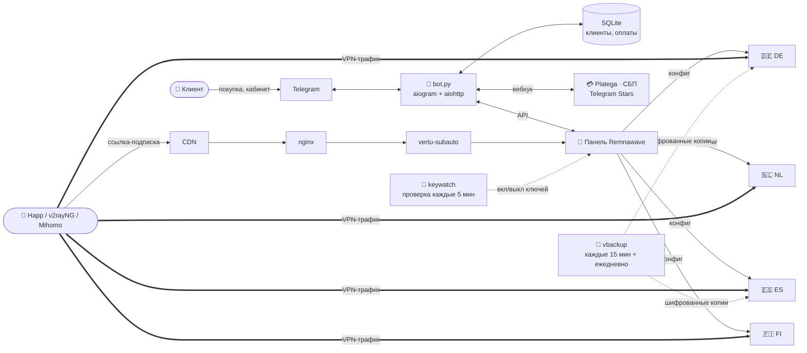
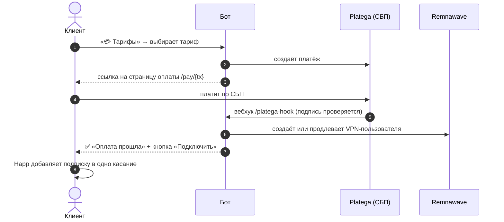
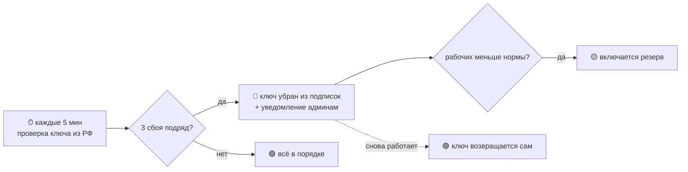

<div align="center">

# 🛡 VAYNAH VPN

**VPN-сервис в Telegram, который не теряет связь, даже когда интернет ограничивают**

[](https://t.me/MyVainakhBot)


[О проекте](https://sub.vertuwpn.ru/project) · [Бот](https://t.me/MyVainakhBot) · [Поддержка](https://t.me/helpingvpn)

</div>

---

## ✨ Коротко

Клиент открывает бота **@MyVainakhBot**, берёт пробный период или оплачивает тариф и получает **одну ссылку-подписку**. Приложение (Happ, v2rayNG, Clash/Mihomo) подтягивает по ней все серверы. Всё остальное делает система:

- 🌍 серверы в **Германии, Нидерландах, Испании и Финляндии**;
- 🔀 **4 независимых способа подключения**: если один блокируют, остаются другие;
- 🤖 каждые 5 минут **робот проверяет каждый ключ из России**, убирает нерабочие и включает резерв;
- 💾 **зашифрованные бэкапы** каждые 15 минут и ежедневно, на 4 серверах в разных странах;
- 🚑 **аварийный переезд** на запасной сервер, если главный упадёт.

В этом репозитории лежит **бот и его веб-часть**: личный кабинет, страницы оплаты и подключения, веб-админка.

---

## 🧭 Как всё устроено



**Три слоя:**

| Слой | Что делает | Где живёт |
|---|---|---|
| **Бот** | Продажи, пробный период, кабинет, оплата, поддержка, админка | этот репозиторий (`bot.py` и модули) |
| **Панель Remnawave** | Хранит VPN-пользователей и ключи, собирает подписки, раздаёт конфиг на серверы | Docker на главном сервере |
| **Ноды** | Сами VPN-серверы на Xray: принимают подключения клиентов | DE, NL, ES, FI |

---

## 🔀 Четыре пути подключения

В подписке у каждого клиента лежат ключи разных типов. Они идут к серверам **разными дорогами**, поэтому заблокировать всё сразу очень сложно.

| | Путь | Как работает | Для чего |
|---|---|---|---|
| 🟢 | **Reality через российский вход** | Клиент подключается к российскому адресу, оттуда трафик уходит в Европу. Для провайдера это выглядит как заход на крупный сайт | Основной, лучший для мобильного интернета |
| 🔷 | **Reality напрямую** | Сразу к серверу через собственные поддомены | Домашний Wi-Fi, не зависит от российского входа |
| ⚡ | **Hysteria2 (UDP)** | Современный протокол, для провайдера выглядит как HTTP/3. Через российский вход и напрямую, резерв на втором порту | Самый быстрый, держит скорость на плохой связи |
| 🟡 | **Резервные каналы через CDN** | XHTTP через российские сети доставки контента, как у обычных сайтов | Когда прямые пути закрыты |

> Сделать VPN, который нельзя заблокировать в принципе, невозможно. Реальная цель другая: **блокировка одного пути не отключает клиента.**

---

## 💳 Как проходит покупка



Если вебхук не дошёл, фоновый обработчик сам перепроверяет зависшие платежи.

---

## 🤖 Что умеет бот

<table>
<tr><td width="50%" valign="top">

**Для клиента**
- 🎁 Пробный период: 1 день, по ссылке с листовки 2 дня после подписки на канал
- 💳 Оплата: СБП (Platega), Telegram Stars, продление, автопродление
- 🏔 Личный кабинет в боте и на веб-странице `/me/{uuid}`
- 📱 Устройства: лимит, смена ключа, расширение до 5
- 👥 Реферальная программа, промокоды, амбассадоры
- 📖 Инструкции для iPhone, Android, Windows, Mac
- 🩺 Быстрые ответы: «Нет интернета», «Медленно», «Не подключается»
- 💬 Поддержка прямо из бота

</td><td width="50%" valign="top">

**Для админа** (веб-админка `/admin/`)
- 📊 Статистика, выручка, конверсия, источники трафика
- 🎯 Промокоды, ссылки с отслеживанием, автоворонка, рассылки
- 👤 Поиск клиента, продление, выдача дней, лимиты
- 🔑 Вкладка «Ключи»: состояние каждого ключа в реальном времени
- 🖥 «Новая нода»: сервер подключается одной кнопкой
- 👑 Админы и амбассадоры
- 📈 Ежедневный отчёт воронки в 09:00 МСК

</td></tr>
</table>

### Тарифы

| Тариф | Срок | Устройств | Цена |
|---|---|---|---|
| 🎁 Пробный | 1 день (по ссылке 2 дня) | до 3 | бесплатно |
| 🔥 Старт (первая оплата) | 7 дней | до 3 | 50 ₽ |
| 📦 Стандарт | 1 · 3 · 6 · 12 мес | до 3 | 199 · 499 · 899 · 1 590 ₽ |
| 👨‍👩‍👧‍👦 Семейный | 1 · 3 · 6 · 12 мес | до 5 | 299 · 749 · 1 350 · 2 390 ₽ |

Цены и сроки задаются в `PLANS` в `bot.py` и переопределяются из админки (таблица `settings`).

---

## 📁 Структура репозитория

| Файл / папка | Назначение |
|---|---|
| `bot.py` | 🧠 Сердце проекта: Telegram-бот (aiogram 3) и веб-сервер (aiohttp). Тарифы, оплаты, выдача ключей, вебхуки, маршруты страниц |
| `admin_web.py` · `admin_web.html` | Веб-админка `/admin/`, вход по одноразовой ссылке из бота |
| `me_cabinet.py` | Личный кабинет `/me/{uuid}`: статус, QR, копирование ссылки, живой статус локаций |
| `rw_sync.py` | Синхронизация пользователей бота с Remnawave |
| `ghal.py` | Персонаж VAYNAH BRO: HTML-виджеты и Rich Messages в Telegram |
| `site_stats.py` | Статистика сайта, ссылки `/go/{tag}`, ежедневный отчёт воронки |
| `game.py` · `game/` | Мини-игра (Telegram Mini App). Сейчас **не подключена** к боту |
| `redirector.py` | Старый бот: отвечает одной кнопкой «Открыть нового бота VAYNAH» |
| `pay_page.html` | Своя страница оплаты `/pay/{tx}` |
| `device_page.html` · `happ_page.html` · `incy_page.html` | Страницы подключения устройств и приложений |
| `stub_index.html` | Главная страница домена |
| `legal/` | Пользовательское соглашение, политика конфиденциальности, тарифы |
| `web/` | Картинки страниц и `project.html`: публичная страница [о проекте](https://sub.vertuwpn.ru/project) |
| `assets/` | Логотипы и баннеры бренда |
| `keywatch_cfg.json` | Порядок резервных ключей для робота проверки |
| `requirements.lock` | Точные версии Python-зависимостей |
| `bot.env.example` | Шаблон настроек: только названия, без значений |

---

## ⚙️ Сервисы на сервере

| systemd-сервис | Что делает |
|---|---|
| `ingvertuvpn-bot` | Бот + веб-сервер (`bot.py`), работает от пользователя `ingvertu` |
| `ingvertuvpn-redirector` | Старый бот → перенаправляет в новый |
| `vertu-subauto` | Прослойка перед подпиской: группы серверов для Mihomo и правки под клиентов |
| `vertu-keywatch` | Робот проверки ключей из России |
| `vertu-infra` | Автоматизация инфраструктуры: «Новая нода», маршруты |
| `vertu-backup.timer` | Бэкапы каждые 15 минут + ежедневные копии баз |
| `vguard` | Защита от «раздвоения» главного сервера при аварийном переезде |

> Сервисы `vertu-*` и `vguard` живут в своих папках (`/opt/vertu-*`, `/opt/vwatch`) и в этот репозиторий пока не входят.

---

## 🛟 Надёжность



| Что | Как часто | Хранение |
|---|---|---|
| Копия базы бота | каждые 15 минут | 2 дня |
| Дамп базы панели | каждый час | 7 дней |
| **Ежедневная копия обеих баз** | раз в день (~04:00 МСК) | **30 дней** |
| Полный снимок (код, конфиги, сервисы) | раз в день | 30 дней |
| Проверка восстановления | каждую ночь на отдельном сервере | — |

Все копии шифруются (AES-256) и раскладываются на 4 сервера в разных странах. Если главный сервер упадёт, управление автоматически переезжает на запасной. Проверено на живой системе: около 11 минут до восстановления.

---

## 🚀 Развёртывание

```bash
# 1. Код
git clone git@github.com:TETRIX8/vaynah-bot.git /opt/zpnbot
cd /opt/zpnbot

# 2. Окружение Python
python3 -m venv venv
venv/bin/pip install -r requirements.lock

# 3. Настройки (секреты — только здесь, не в git)
sudo mkdir -p /etc/ingvertuvpn
sudo cp bot.env.example /etc/ingvertuvpn/bot.env   # заполнить значения
sudo chmod 600 /etc/ingvertuvpn/bot.env

# 4. Сервис
sudo systemctl enable --now ingvertuvpn-bot
journalctl -u ingvertuvpn-bot -f
```

Бот стартует около 30 секунд: только после этого веб-сервер начинает отвечать.

### Настройки (`/etc/ingvertuvpn/bot.env`)

| Переменная | Что это |
|---|---|
| `BOT_TOKEN` · `BOT_USERNAME` | Токен и имя бота |
| `LEGACY_BOT_TOKEN` | Токен старого бота (для `redirector.py`) |
| `INGVERTU_ADMIN_ID` | Telegram ID админов через запятую |
| `INGVERTU_DB` | Путь к базе SQLite |
| `INGVERTU_RW_API` · `INGVERTU_RW_TOKEN` | Адрес и токен API Remnawave |
| `INGVERTU_RW_SQUAD` · `INGVERTU_RW_SQUAD_PAID` | Группы (сквады) Remnawave для пробных и платных |
| `INGVERTU_PANEL_URL` | Адрес панели |
| `INGVERTU_SUB_DOMAIN` · `INGVERTU_SUB_PATH` · `INGVERTU_SUB_LINK_DOMAIN` | Домен веб-страниц и ссылок-подписок |
| `INGVERTU_WEBAPP_BIND` | Где слушает веб-сервер бота |
| `INGVERTU_ACCESS_ISSUANCE_ENABLED` | Включает выдачу доступа |
| `INGVERTU_RELAY_SECRET` · `INGVERTU_INFRA_KEY` | Внутренние ключи между сервисами |
| `PLATEGA_MERCHANT_ID` · `PLATEGA_SECRET` · `PLATEGA_METHODS` | Приём оплаты через Platega |

---

## 🔄 Как вносить правки

```bash
cd /opt/zpnbot
# ...правка...
venv/bin/python -m py_compile bot.py            # проверить синтаксис
sudo systemctl restart ingvertuvpn-bot           # применить (~30 сек старт)
git add -A && git commit -m "что изменено" && git push
```

`web/project.html` и HTML-страницы в `legal/` читаются на каждый запрос, для них перезапуск не нужен.

---

## 🔒 Что **не** хранится в репозитории

`.gitignore` закрывает всё, чему не место в git:

- 🗄 базы данных (`*.sqlite3`, `*.db`) и бэкапы (`backups/`);
- 🔑 секреты (`*.env`, `*.key`, `*.pem`). Токены живут только в `/etc/ingvertuvpn/bot.env`;
- 🙂 фото пользователей (`ghal_faces/`) и файлы состояния сервисов;
- 🧹 `venv/`, кэш Python, файлы-копии правок (`*.bak*`, `*.before-*`).

---

<div align="center">

**VAYNAH VPN** · [@MyVainakhBot](https://t.me/MyVainakhBot) · поддержка [@helpingvpn](https://t.me/helpingvpn)

</div>
